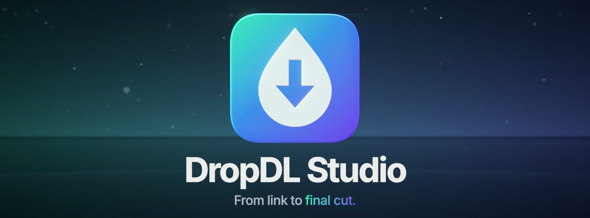
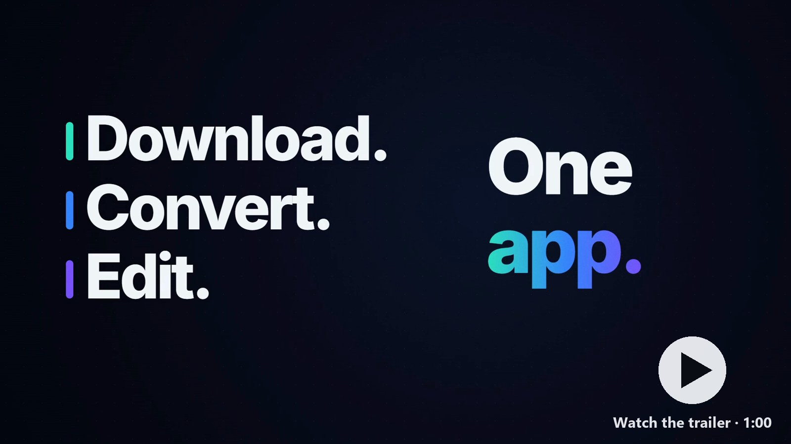
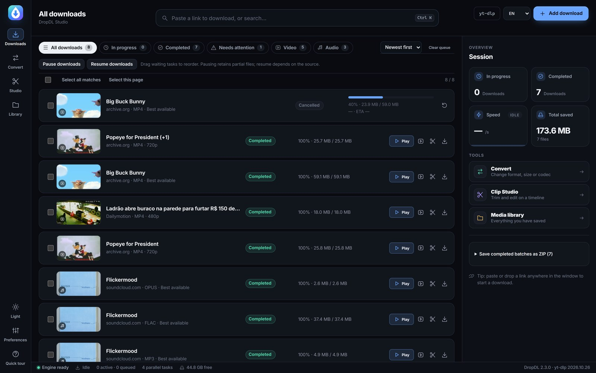
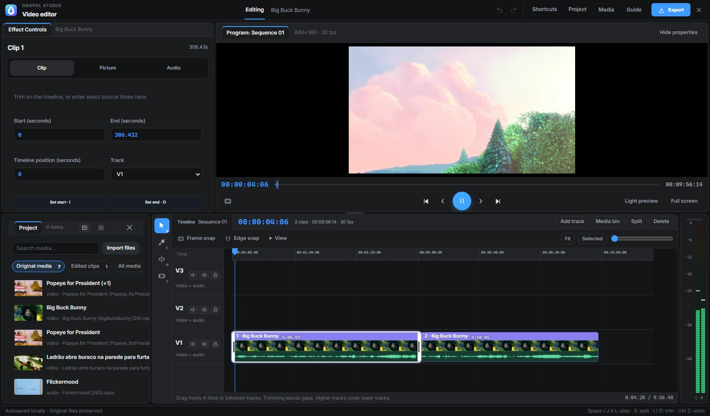
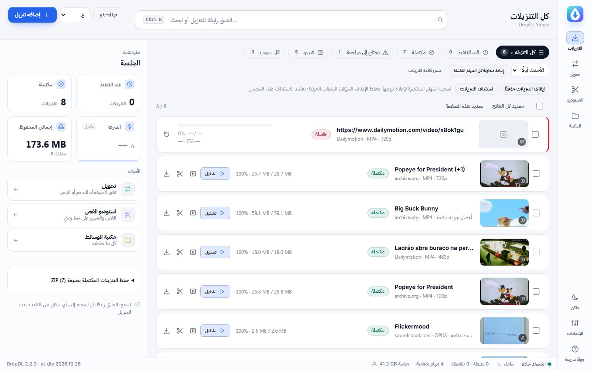

<p align="center">
  
</p>

<p align="center">
  <a href="https://github.com/HamedGhaithan/DropDL/releases/latest"></a>
  <a href="https://github.com/HamedGhaithan/DropDL/actions/workflows/ci.yml"></a>
  <a href="LICENSE"></a>
  
  <a href="CONTRIBUTING.md"></a>
</p>

**DropDL Studio** is a free, open source desktop app that downloads video and audio from the web, converts it to any format, and lets you cut it on a real multi-track timeline, all in one window. It is built on [yt-dlp](https://github.com/yt-dlp/yt-dlp) and [FFmpeg](https://ffmpeg.org), with a modern interface in English and Arabic, dark and light.

<p align="center"><b><a href="https://github.com/HamedGhaithan/DropDL/releases/latest">⬇ Download for Windows</a></b></p>

<p align="center">
  <a href="https://github.com/HamedGhaithan/DropDL/releases/download/v2.3.0/DropDL-Studio-trailer-16x9.mp4"></a>
  <br><sub>▶ Watch the 60-second trailer: <a href="https://github.com/HamedGhaithan/DropDL/releases/download/v2.3.0/DropDL-Studio-trailer-16x9.mp4">16:9</a> / <a href="https://github.com/HamedGhaithan/DropDL/releases/download/v2.3.0/DropDL-Studio-trailer-9x16.mp4">9:16</a></sub>
</p>



## Features

**Download**
- Paste a link anywhere in the window and it starts. Single videos, playlists, channels and pasted batches of links.
- Video, audio, or both: MP4, WebM, MKV, MP3, M4A, Opus, FLAC and WAV, with quality presets.
- Self-healing queue: every download runs in its own worker process, retries on network drops and resumes from the partial file.
- Pause, resume, reorder, prioritise and schedule downloads. Duplicate detection, bandwidth limits and restart recovery.
- Subtitles, chapters, embedded cover art and metadata, and SponsorBlock.

**Convert**
- Presets for H.264 MP4, VP9 WebM, MP3, AAC, WAV, FLAC, ProRes 422 and DNxHR, plus fast container changes without re-encoding.
- Resize, change frame rate, rotate, crop, trim, normalise audio and aim for a target file size. Originals are never overwritten.

**Edit**
- A Premiere-style editing workspace: Effect Controls, Program monitor with SMPTE timecode and J·K·L shuttle, Project bin, tools palette and multi-track timeline.
- Clips show a filmstrip and the real audio waveform. Live stereo meters with peak hold.
- Move, cut, roll and slip edits, snapping, titles and captions, soundtrack, undo/redo, autosave and export presets.

**Everything else**
- Media library with search and filters, subscriptions to playlists and channels, and a browser extension that sends the current tab to the app.
- English and Arabic (full right-to-left layout), dark and light themes, keyboard shortcuts and a command palette.
- Everything stays on your computer. No accounts, no telemetry, no remote error reporting.

| Editor | Arabic, light theme |
| --- | --- |
|  |  |

## Install

1. Download **DropDL-Setup.exe** from the [latest release](https://github.com/HamedGhaithan/DropDL/releases/latest).
2. Run it. It installs the app for your user and fetches what it needs (Python, Node.js, FFmpeg and WebView2) if they are missing, so the first install needs an internet connection.
3. Open **DropDL Studio** from the Start menu.

Requires Windows 10 (1809 or later) or Windows 11, 64-bit. To update, run a newer setup over the old one; your downloads, library and settings are kept.

The installer is not code-signed yet, so Windows SmartScreen may show **Unknown publisher**. Choose **More info → Run anyway**, or build it yourself from source (below).

The [user guide](docs/USER-GUIDE.md) covers every feature in detail, and the [changelog](CHANGELOG.md) lists what changed in each version.

## Run from source

You need **Python 3.12+**, **Node.js 22+** and **FFmpeg/ffprobe** on your `PATH`.

```bash
git clone https://github.com/HamedGhaithan/DropDL.git
cd DropDL
python -m venv .venv
.venv\Scripts\activate            # macOS/Linux: source .venv/bin/activate
pip install -r backend/requirements.txt -r requirements-dev.txt
cd frontend && npm ci && npm run build && cd ..
python backend/desktop.py         # opens the desktop window
```

For interface work with hot reload, run the backend with `python backend/run.py` and, in a second terminal, `npm run dev` inside `frontend` (the dev server proxies to the backend on port 17321).

On Windows, `Setup-DropDL.bat` does all of the above for you, and `Start-Desktop.bat` launches the app.

### Project layout

```
backend/            FastAPI server, download/convert/edit workers (Python)
  app/              API, scheduler, yt-dlp and FFmpeg integration
  desktop.py        native window (pywebview / WebView2)
frontend/           React 19 + TypeScript interface (Vite)
  src/              App, editor, timeline, library, i18n (English/Arabic)
browser-extension/  Chrome/Edge extension that sends links to the app
installer/          NSIS scripts for the Windows setup and launcher
scripts/            build, packaging and signing scripts
tests/              pytest suites and Node UI/model checks
docs/               user guide and images
```

### Tests

```bash
python -m pytest tests -q           # backend (isolated temp profile, never your real data)
cd frontend
npm run test:ui                     # interface regression suite (jsdom)
npm run test:timeline               # timeline model
npm run test:fps && npm run test:pro
```

Browser suites (`test:editor`, `test:library`, `test:player`) need Playwright; see [CONTRIBUTING.md](CONTRIBUTING.md).

### Build the Windows installer

```powershell
cd frontend; npm ci; npm run build; cd ..
python scripts/build-installer.py   # needs NSIS (makensis) on PATH; writes dist/DropDL-Setup.exe
```

## Contributing

Contributions of every size are welcome: bug reports, translations, docs, design and code. Read **[CONTRIBUTING.md](CONTRIBUTING.md)** to get set up, then pick an issue labelled [`good first issue`](https://github.com/HamedGhaithan/DropDL/labels/good%20first%20issue) or [`help wanted`](https://github.com/HamedGhaithan/DropDL/labels/help%20wanted). Please follow the [code of conduct](CODE_OF_CONDUCT.md).

Found a security problem? Please report it privately as described in [SECURITY.md](SECURITY.md), not in a public issue.

## Responsible use

DropDL Studio is a tool. Only download content you own, content that is in the public domain or under a licence that allows it, or content you otherwise have permission to save. Respect each website's terms of service and the copyright laws where you live. DropDL does not bypass DRM.

## Credits and licence

DropDL Studio is released under the [MIT License](LICENSE).

It stands on the shoulders of [yt-dlp](https://github.com/yt-dlp/yt-dlp) (Unlicense), [FFmpeg](https://ffmpeg.org) (LGPL/GPL, installed separately at setup), [FastAPI](https://fastapi.tiangolo.com), [pywebview](https://pywebview.flowrl.com), [React](https://react.dev) and [Vite](https://vite.dev). Interface fonts are [Inter](https://rsms.me/inter/) and [IBM Plex Sans Arabic](https://github.com/IBM/plex), both under the SIL Open Font License. See [THIRD-PARTY-NOTICES.md](THIRD-PARTY-NOTICES.md).
